# Sweet Flight - Controle de Vendas de Passagens Aéreas

3ª Avaliação (Situação de Aprendizagem) de Programação Orientada a Objetos.
IFSC Lages, Ciência da Computação, GCC2, 2026/2. Professor Edinilson da Silva Vida.

## Integrantes (Grupo 5)

- Daniel José Palumbo Rodrigues
- Gustavo Duara
- Mateus Munaretto Fogaça de Almeida
- Matheus Camilo Belli
- Murilo Sander de Lima Cruz

## Requisitos

- JDK 17 ou superior (testado com o JDK 21)
- Classe de entrada: `br.edu.ifsc.sweetflight.Main`

## Como compilar e executar

Os comandos são executados na pasta do projeto.

Windows (PowerShell):

```powershell
javac -encoding UTF-8 -d out (Get-ChildItem -Recurse src -Filter *.java).FullName
java -cp out br.edu.ifsc.sweetflight.Main
```

Linux ou macOS:

```bash
javac -encoding UTF-8 -d out $(find src -name "*.java")
java -cp out br.edu.ifsc.sweetflight.Main
```

No NetBeans: **File > Open Project**, escolher a pasta e executar a classe `Main`.

## Organização

| Pacote / classe | Responsabilidade |
|---|---|
| `Main` | Inicia o programa |
| `model.Voo` | Dados do voo e controle de assentos |
| `model.Passageiro` | Dados do passageiro |
| `model.Venda` | Liga voo e passageiro, guarda valor e situação |
| `model.SituacaoVenda` | Confirmada ou cancelada |
| `service.CentralVendas` | Regras de negócio e coleções em memória |
| `service.ResumoVoo` | Resultado do resumo por voo |
| `service.RegraNegocioException` | Motivo de uma operação recusada |
| `ui.MenuConsole` | Menu e exibição |
| `ui.LeitorEntrada` | Leitura e conversão do que é digitado |

## Demonstração

As imagens abaixo foram capturadas de uma janela de console real do Windows, executando o programa com os dados a seguir.

| Voo | Origem | Destino | Partida | Capacidade | Tarifa |
|---|---|---|---|---|---|
| SF101 | Lages | São Paulo | 15/12/2026 08:00 | 1 | 250,00 |

| Passageiro | Nome |
|---|---|
| P1 | Gustavo Duara |
| P2 | Daniel José Palumbo Rodrigues |

O voo tem só um assento, para mostrar o que acontece quando ele lota e quando uma venda é cancelada.

### 1. Cadastrar o voo (opção 1)

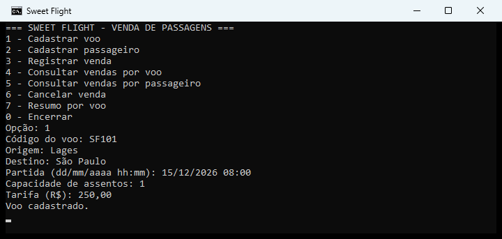

### 2. Cadastrar os passageiros (opção 2)

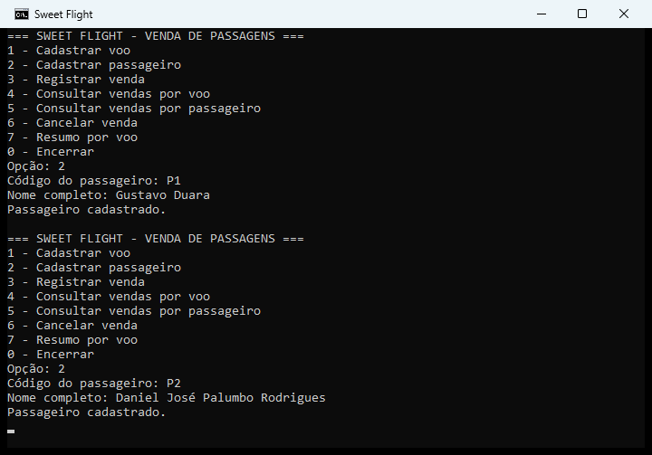

### 3. Registrar uma venda (opção 3)

A venda de SF101 para P1 gera o código `V001`.

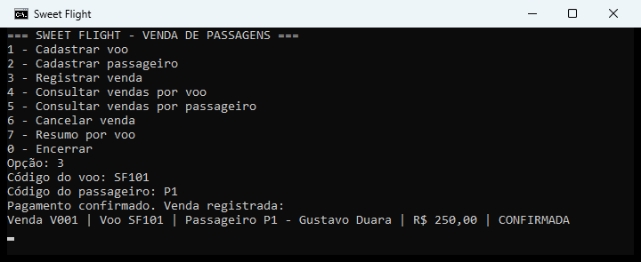

### 4. Resumo do voo lotado (opção 7)

O único assento está ocupado e o total confirmado é R$ 250,00.

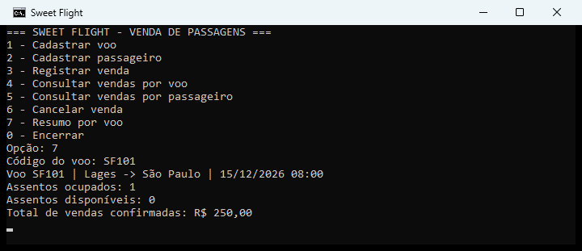

### 5. Venda recusada por falta de vagas (opção 3)

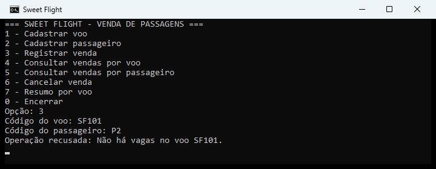

### 6. Consultar vendas por voo (opção 4)

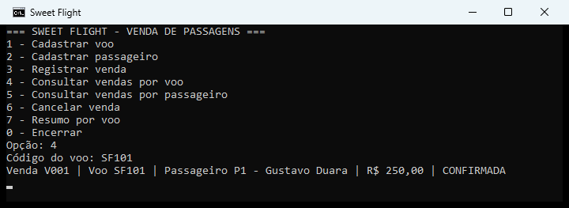

### 7. Consultar vendas por passageiro (opção 5)

P1 tem a venda `V001`; P2 não tem nenhuma.

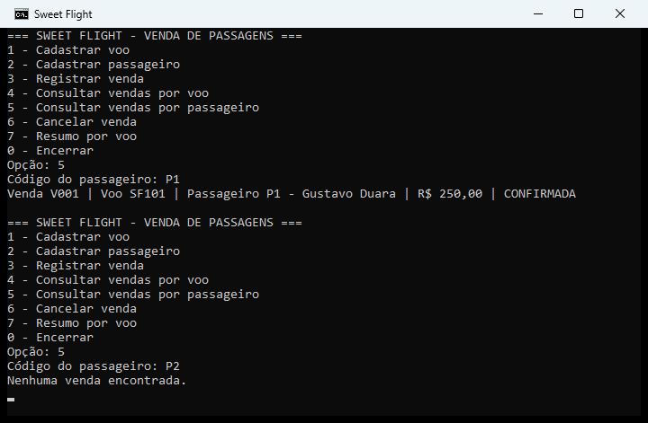

### 8. Cancelar a venda (opção 6)

O cancelamento libera o assento.

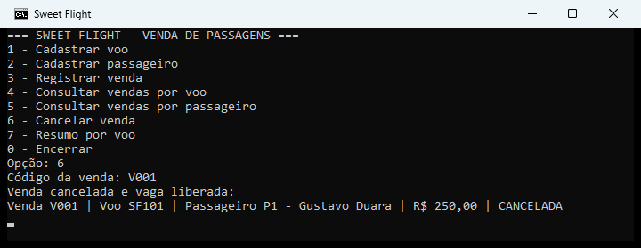

### 9. Resumo e consulta depois do cancelamento

O voo volta a ter 1 assento livre, o total confirmado volta a R$ 0,00 e a venda aparece como `CANCELADA`.

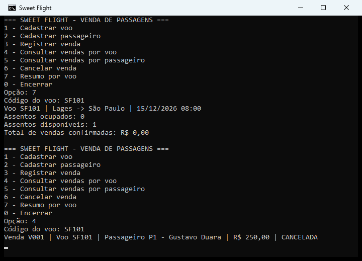

### 10. Cancelar a mesma venda de novo

O sistema recusa e o resumo não muda.

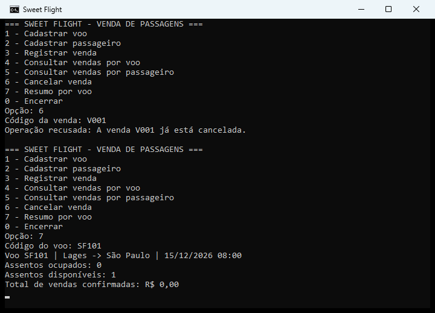

### 11. Entradas inválidas

Uma opção que não existe no menu e uma data impossível (31/02) são recusadas sem encerrar o programa.

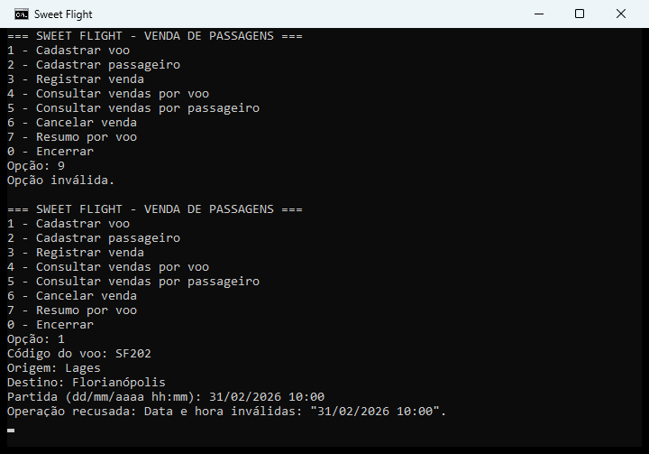
